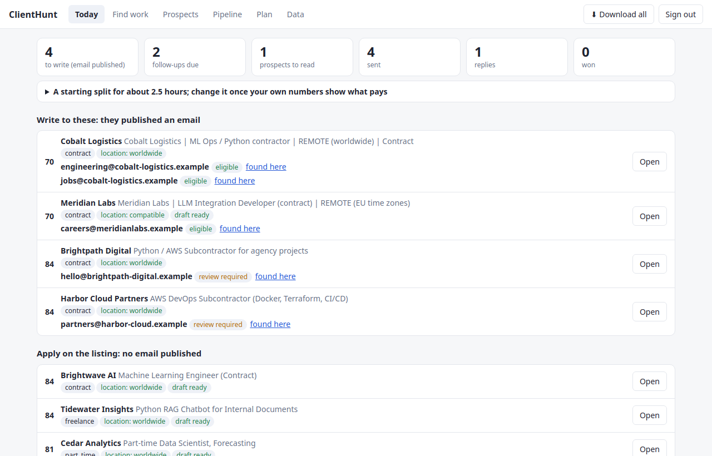
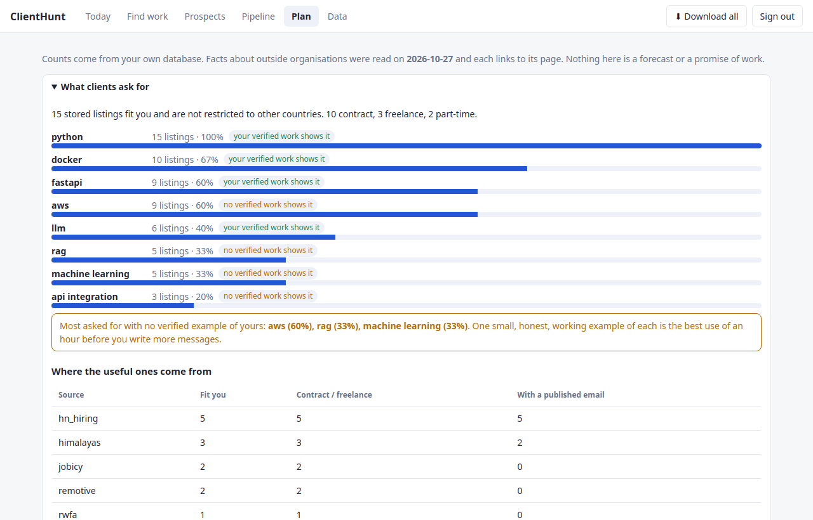
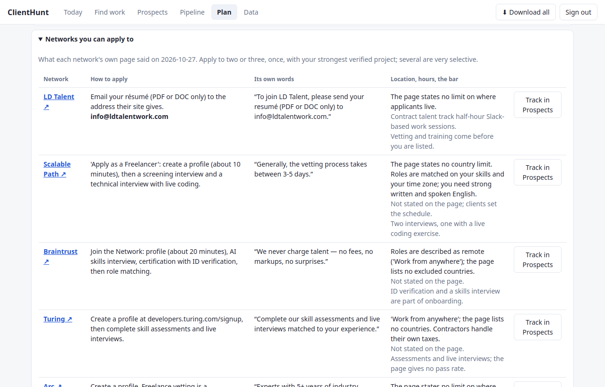
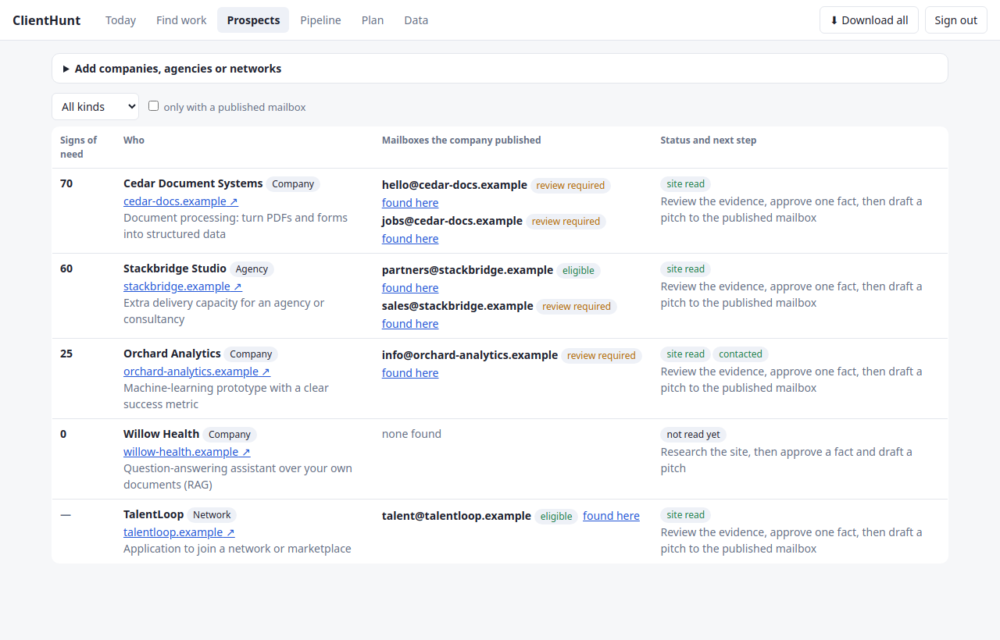
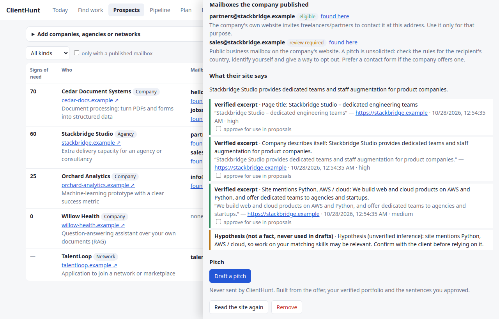
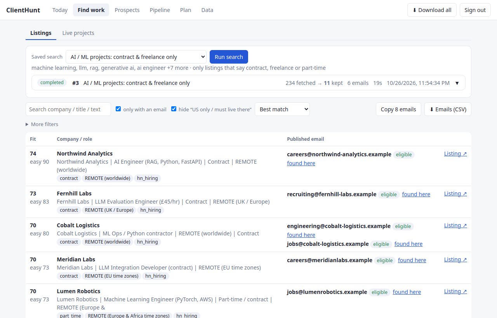
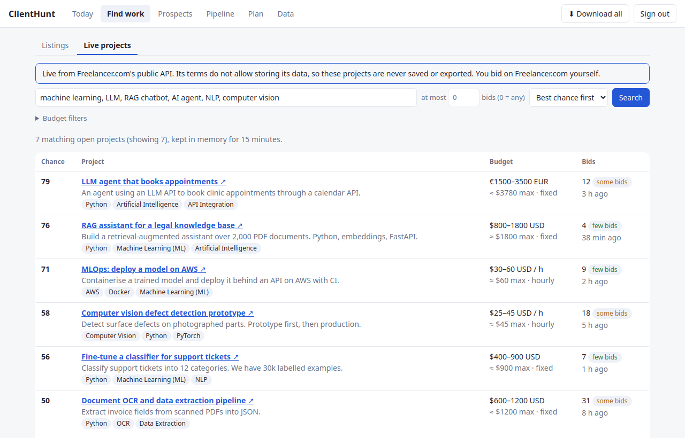
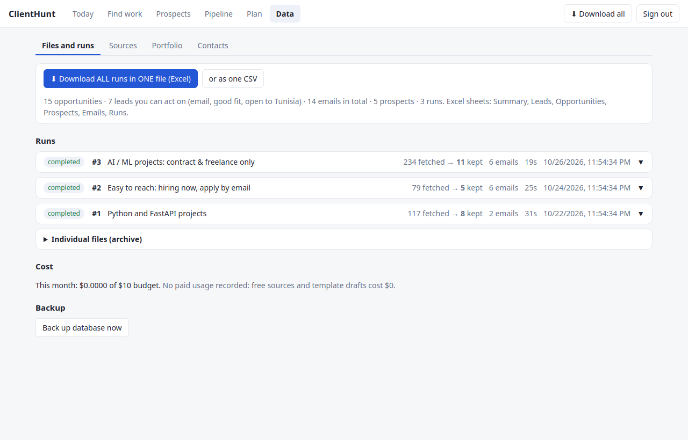
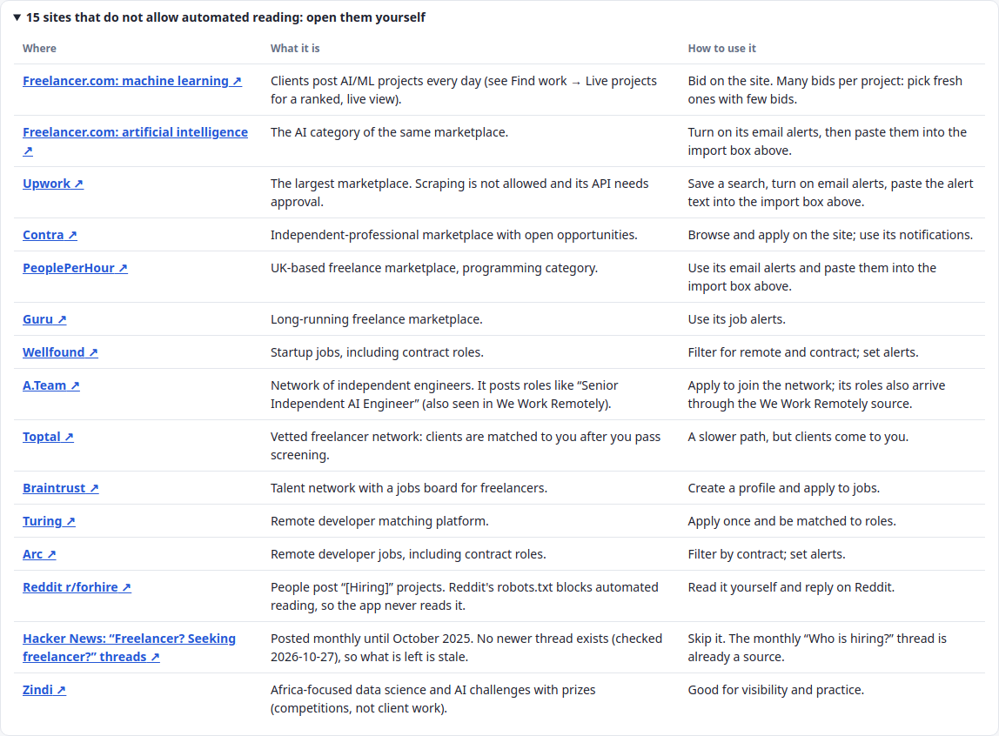

# ClientHunt

A private workspace for finding people and companies that need a Python / AI / ML / LLM / FastAPI / AWS engineer,
**especially those who published an email to apply**. It reads many remote-work sources, ranks the results
transparently, researches the client from public sources with evidence, drafts messages you review, and puts
**everything from all runs into one downloadable file**. A **Strategy** tab turns the stored data into a plan for the day,
and **Prospects** lets you add the companies, agencies and networks *you* choose to approach.
**It never sends or submits anything for you.**



*All screenshots use synthetic demo data: fictional companies, `.example` addresses and a fictional stand-in for the
Freelancer.com API. Nothing in them is a real opportunity or a real person.*

## Tools used

**Database**: every run, opportunity, company, evidence quote, contact, draft, application and export is stored in a
database. SQLite by default (one file, `data/clienthunt.db`), PostgreSQL 16 with Docker Compose. Tables are created
and upgraded by Alembic migrations (4 so far) through the SQLAlchemy ORM.

[](https://www.sqlite.org/)
[](https://www.postgresql.org/)
[](https://www.sqlalchemy.org/)

**AI**: the app can use an LLM through the Claude API (Anthropic) to write proposal drafts. It is **off by default**,
capped per run and per month, and every draft goes through an unsupported-claim checker. Ranking, de-duplication,
email extraction and the "easy to reach" score are plain rules and need no model. This project was also built with the help
of AI (Claude Code).

[](https://www.anthropic.com/)

**Backend**

[](https://www.python.org/)
[](https://fastapi.tiangolo.com/)
[](https://docs.pydantic.dev/)

**Frontend**

[](https://react.dev/)
[](https://www.typescriptlang.org/)
[](https://vitejs.dev/)

**Testing and packaging** (Playwright is used for the browser test)

[](https://docs.pytest.org/)
[](https://vitest.dev/)
[](https://www.docker.com/)

## Screenshots

| | |
|---|---|
| **Today: the plan for the day, built from your own data** <br>  | **What clients ask for, and the skills your verified work does not show yet** <br>  |
| **Networks to apply to: their own words, location limits and the bar** <br>  | **Prospects: companies and agencies you choose, with the mailboxes they published** <br>  |
| **A prospect: where each mailbox came from and what its site says** <br>  | **Find work: pick a search, one click, and the companies hiring now with the email they published** <br>  |
| **Live projects: clients who need AI/ML work right now, with competition shown** <br>  | **Transparent score, "easy to reach" signals and published emails** <br>  |
| **Company research: verbatim quotes with source and time; inferences kept apart** <br>  | **Proposal draft with rationale, cited portfolio and approval gates** <br>  |
| **Files and runs: one file for everything, per-run files tucked away** <br>  | **Pipeline: only what you really sent, with your replies and your own follow-ups** <br>  |

## What it does

| Area | Behaviour |
|---|---|
| **One file for everything** | **⬇ Download ALL runs in ONE file (Excel)** is on the Overview, Research, Leads and Runs pages. The workbook has the sheets *Summary, Leads, Opportunities, Prospects, Emails, Runs*. Each opportunity appears once even if several runs found it, and every row keeps its links. There is also a single flat CSV. It is built on demand from the database, so it is always current and adds no files. Text is stored as text (never a formula) and only http(s) links are clickable. |
| **Strategy** | The **Strategy** tab is the plan for the day, built from what is stored: the open leads to write to (contract and freelance first, never ones restricted to other countries), listings to apply to by link, follow-ups that are due (day 4, day 10, then stop), prospects to read or pitch, and portfolio items still unverified. It counts which skills clients ask for and flags the ones your *verified* work does not show, says which offers you can back with verified work, lists networks with **their own words** and the date they were read, and gives the weekly rhythm, the message shape, a spending plan for a $50-200 budget and an income calculator you can change. Percentages and medians appear only when there is enough data; the hourly rate stays hidden until at least 8 listings state one. |
| **Prospects** | The **Prospects** tab is for companies, agencies and networks *you* choose. You paste websites; ClientHunt reads their own public pages (robots.txt respected, private addresses refused), keeps verbatim excerpts, finds the role mailboxes they published (same domain only, with page and date) and lists public signs they may need AI/automation/cloud work. A pitch to a published mailbox is unsolicited, so it stays `review_required` unless the site itself invites freelancers or contractors there. Drafts use a fixed offer, your verified portfolio and facts you approved, include an opt-out line, and are never machine-generated. Networks are not scored. |
| **Leads and emails** | The **Leads** tab lists companies hiring now with the email *they* published (in their hiring post, or a careers/contact mailbox on their own website), plus where and when it was found. Emails are never guessed and never taken from Upwork or Fiverr. Each is `eligible` (the company invited applications there) or `review_required`. Addresses for accommodation requests, fraud reports, privacy or legal questions are rejected, ordinary job boards must contain clear "apply / send your resume" wording, and people advertising *themselves* in a hiring thread are never collected. |
| **Live projects** | The **Live projects** tab shows open Freelancer.com projects for AI/ML (public API) with budget, number of bids, age and a "chance" score = fit for you − competition + freshness. Freelancer.com's API terms forbid storing its data, so this view is **never saved, exported or added to runs**. You bid there yourself. |
| **Sources** | Remotive, Remote OK, Himalayas, Jobicy, We Work Remotely, Real Work From Anywhere, the Python Job Board and Hacker News "Who is hiring?"; **alert-email import** (Upwork, Contra, PeoplePerHour, Guru, Wellfound…); manual add. See the table below. |
| **Saved searches** | Seven presets, including **AI / ML projects: contract & freelance only** (only listings that say so, open to Tunisia, fit ≥ 35) and **Easy to reach: hiring now, apply by email**. Roles restricted to other countries ("UK", "US only", "LATAM, Argentina") are dropped up front. So are on-site and hybrid roles, an explicit country list that does not name Tunisia or a region containing it (`Only: Egypt, South Africa` does not include Tunisia), and a listing whose *text* says "Location: LATAM" or "must be located in the US" even when its location field says "Worldwide". Hiring posts edited to say "CLOSED" are not offered as leads. |
| Easy to reach | A 0–100 heuristic from visible signals: email to apply (+30), contract/freelance wording (+20), open to any location (+15), posted this week (+10), wants someone soon (+10), small team (+5), several openings (+5); minus for "no contractors/agencies" and location or work-authorisation limits. It shows *why*. It is not a hiring prediction. |
| Ranking | 0–100: skills 35, portfolio relevance 25, budget 15, information quality 10, remote/location 10, freshness 5. Unknown data scores 0 and is listed. Location-restricted listings are capped at 50 and clearly non-engineering titles at 30 (judged by role words such as *engineer* or *scientist*, not by topics such as "AI"). Only portfolio items you mark *verified* earn points or get cited. You can override a score or exclude a listing. |
| Company research | Fetches the company's own site (SSRF-safe, robots.txt respected). Facts are verbatim excerpts checked against the page, with URL and timestamp; inferences are stored separately as hypotheses and never used in drafts. You approve each fact before it can appear in a proposal. |
| Drafts | Free template drafts (from the listing, your verified portfolio and approved facts) or optional LLM drafts. The checker flags invented years, results, certifications, URLs, compliments and off-platform contact details. Editing resets approval. Approved is not submitted. |
| Per-run CSVs | Every completed or partial run also writes its own `opportunities_*.csv` and `emails_*.csv` (also with zero rows), timestamped and never overwritten, SHA-256 recorded and checked on download. They sit in a collapsed *Individual files (archive)* section, with a ZIP of all of them. Failed runs produce no CSV. |
| Jobs | Runs are database rows executed by a worker thread: pending, running, completed, partial, failed, cancelled, with progress, retries, cancel and restart recovery. |
| Contacts | Separate tables from opportunities. Source URL, date and snippet are kept for every address, with eligibility checks, a suppression list and a `forget` command. |

## Quick start (local, no Docker)

```bash
python3 -m venv backend/.venv && backend/.venv/bin/pip install -r backend/requirements-dev.txt
cd frontend && npm ci && npm run build && cd ..
cp .env.example .env            # set APP_PASSWORD and SESSION_SECRET (or run ./scripts/setup.sh)
cd backend && .venv/bin/alembic upgrade head
.venv/bin/uvicorn app.main:app --port 8765        # open http://127.0.0.1:8765
```

## Quick start (Docker, PostgreSQL)

```bash
./scripts/setup.sh              # writes .env with generated secrets and prints the login password
docker compose up -d --build    # http://127.0.0.1:8080  (bound to localhost only)
```

Put a TLS reverse proxy in front before exposing it beyond your machine, and set `COOKIE_SECURE=true`.

## How to use it

1. **Research** tab → the saved search **AI / ML projects: contract & freelance only** is preselected → **Run Research** (about 20 seconds).
2. Click **⬇ Download ALL runs in ONE file (Excel)**. That one file has every run, each opportunity once, with the leads and emails.
3. **Leads** tab: companies that published an email. Open the original listing first, then *Details / draft* for the score breakdown, company research and a draft.
4. **Live projects** tab: current Freelancer.com projects with few bids and a fresh posting are the best chance. Open and bid there.
5. Edit and approve a draft, submit it yourself on the platform or by your own email, then click *I submitted this* and track replies in **Pipeline**.
6. **Strategy** tab: start each session there. It lists today's leads, follow-ups and prospects. Log your own follow-ups in Pipeline ("I followed up") so the next one is counted from the right day.
7. **Prospects** tab: paste the websites of companies or agencies you want to approach (or press *Track in Prospects* next to a network on the Strategy tab), read the evidence, approve one fact, draft the pitch and send it yourself.

For Upwork, create saved searches with email alerts there and paste the alert text into **Sources & settings → Alert import**.
Under **Sources & settings** you also mark which portfolio items are verified. Only verified items are scored and cited.

## Sources and access

Checked while building this; terms change, so check them before relying on any row.

| Source | Access | Notes |
|---|---|---|
| [Remotive](https://github.com/remotive-com/remote-jobs-api) | public API, no key | at most about 4 fetches a day (cached 6 h), 24 h delay, link back and credit Remotive |
| [Remote OK](https://remoteok.com/api) | public API, no key | link back and credit Remote OK |
| [Himalayas](https://himalayas.app/api) | public API, free key optional | use the application link unchanged, link to Himalayas |
| [Jobicy](https://jobicy.com/jobs-rss-feed) | public API, no key | terms read: credit Jobicy, link to its listing, storing allowed, poll at most hourly; has real Contract/Freelance listings |
| [We Work Remotely](https://weworkremotely.com/remote-job-rss-feed) | public RSS | robots.txt allows; its terms page blocked automated reading, so terms are **not verified** (polled every 6 h, links back); includes A.Team independent-engineer roles |
| [Real Work From Anywhere](https://www.realworkfromanywhere.com) | public RSS | RSS advertised on the site, robots.txt allows, no terms page found; every role is work-from-anywhere |
| [Python Job Board](https://www.python.org/jobs/) | public RSS | robots.txt allows; legal pages could not be read; items have no date |
| [Hacker News](https://hn.algolia.com/api) | Algolia search API, no key | monthly "Who is hiring?" threads; rate limit not verified; the main source of published application emails |
| [Freelancer.com](https://developers.freelancer.com) | public API, **live view only** | its [API terms](https://www.freelancer.com/about/apiterms) say "You may not copy or store any Data" (cache only, refreshed within 24 h), so projects are shown live and never stored or exported |
| Upwork | [API needs approval](https://support.upwork.com/hc/en-us/articles/115015857647-How-to-request-an-API-key-from-Upwork) | scraping is not allowed, so it is used through alert emails you import |
| Hacker News "Freelancer? Seeking freelancer?" | not used | posted monthly until October 2025; no newer thread exists (checked 2026-10-27), so it is stale |
| Web search APIs (to find company sites) | not used | [Brave's terms](https://api-dashboard.search.brave.com/terms-of-service) (section 3(b)(i)) forbid to "store, cache, or create a database of Search Results" except transient storage, and this app must keep its evidence; Google's Custom Search JSON API is closed to new customers |
| Reddit r/forhire | not used | its robots.txt disallows automated access; read it yourself |
| TED (EU tenders) | not used | open API, but public tenders need EU-registered bidders and are a poor fit for a solo engineer |
| Working Nomads | not used | a public JSON feed exists but no terms could be found |
| Fiverr, PeoplePerHour, Guru, Contra, Wellfound | none verified | no permitted discovery API was found; not scraped |

**More places to look by hand** (Sources & settings lists them with how to use each): Freelancer.com category pages, Upwork,
Contra, PeoplePerHour, Guru, Wellfound, A.Team, Toptal, Braintrust, Turing, Arc, Reddit r/forhire, and Zindi for African AI challenges.



## Why there is no Upwork scraper

A natural idea is to collect company names from Upwork and then search for their emails. It is **not built, on purpose**:

- Upwork's help center says automated tools that act faster than a person can lead to warnings or bans, and that approved API access is the permitted route
  ([use bots and other automation properly](https://support.upwork.com/hc/en-us/articles/43342677368467-Use-bots-and-other-automation-properly)).
- It also treats contact outside Upwork before a contract starts as circumvention of its terms
  ([why can't I get paid directly](https://support.upwork.com/hc/en-us/articles/360048105134-Why-Can-t-I-Get-Paid-Directly)). That risks the account you would use for your best channel.
- An address found by searching for a company name was not published as an invitation to be contacted about a project. The email rules below refuse to treat it as one.
- The original brief for this project said not to scrape Upwork or Fiverr and not to bypass logins, CAPTCHAs or rate limits.

Upwork blocks automated reading of those two pages (HTTP 403), so the summary above comes from search results about them: read the current text yourself.
What the app does instead: it imports the Upwork **alert emails you already receive**, shows Freelancer.com projects live through its API, lets you name the companies
and agencies to read under **Prospects**, and lists the hiring posts whose company published its own address.

## Safe by design

- Nothing is sent or submitted for you. Drafts need your approval, and "submitted" is only recorded when you say so.
- Emails come only from text the company published itself, always with source URL and date. They are format-checked, never "verified".
- `eligible` is a narrow judgement: the company invited applications at that address, so use it only for that purpose.
  Anything else is `review_required`. Suppress anyone who asks not to be contacted; `python -m app.cli forget someone@example.com`
  deletes a contact but keeps a suppression entry.
- Retrieved pages, feeds, job posts and files are treated as untrusted data: XML is parsed with `defusedxml`, HTML is reduced to text,
  and only `http(s)` links are ever stored or clickable. Instructions inside them are never followed.
- Platform terms are respected: Freelancer.com data is never stored, Reddit is not read, Upwork and Fiverr are not scraped.
- A **prospect** is always a site *you* named. Only public http(s) addresses are accepted (localhost, private ranges, credentials and non-web links are refused), the site is read with
  the same SSRF-safe, robots.txt-respecting fetcher, and mailboxes are taken only from the company's own domain and only role names (`contact@`, `partners@`, `jobs@` ...), never a named person.
  A published mailbox is not permission to market: a pitch there stays `review_required`, carries an opt-out line, and is written without a model.
- The **Strategy** tab never shows a figure it cannot back: no hourly rate below 8 observations, no reply or win rate below 10 logged messages, no income forecast (only arithmetic on assumptions you can change).
- Login before any exposure, secrets only in `.env` (git-ignored), input validation and safe spreadsheets and CSVs.
- Cold-email rules differ by country. This is not legal advice.

## Tests

```bash
cd backend && .venv/bin/python -m pytest -q          # 434 passed
cd frontend && npx vitest run                        # 48 passed
cd frontend && npx playwright test                   # 1 passed (login → import → leads → one-file Excel → live projects → draft → approve → record → strategy → prospect → pitch → follow-up)
```

Tests use synthetic data and mocked HTTP (a stub stands in for Freelancer.com). No real email or application is ever sent.
The app was also run against the real public sources: all eight stored sources answered, the one-file workbook opened with
every sheet, and Docker Compose with PostgreSQL started, applied the four migrations, enforced login and served the Prospects and Strategy
endpoints (migration 0004 was also run on a PostgreSQL that already held a row).

## Backups and troubleshooting

- SQLite backup: `./scripts/backup.sh` or `python -m app.cli backup` (also a button under Sources & settings).
  PostgreSQL backup: `./scripts/backup.sh docker` (pg_dump). Restore: `gunzip -c backups/pg_X.sql.gz | docker compose exec -T db psql -U clienthunt clienthunt`.
- `address already in use`: another program uses the port. Start with another one, for example `--port 8765`.
- "Cannot reach the server": the backend is not running or uses another port.
- A source shows `failed`: read its error on the run card, then use *Retry run*. Transient errors are already retried 3 times.
- Remotive, Jobicy and the feeds return the same results for hours: intentional, they are cached to respect their polling limits.
- A source shows `unavailable`: it needs authorisation or has no permitted API. Use Alert import.
- Live projects says Freelancer.com asked us to slow down: wait a few minutes; results are cached for 15 minutes.
- Export failed: check free disk space and permissions of `exports/`, then *Retry export* (this creates a new file).

## Limitations

- **Few worldwide contract/freelance AI/ML listings exist on free boards.** A real run fetched about 1,500 listings and kept about 10 that
  say contract or freelance, are open to Tunisia and match AI/ML. Freelancer.com has many more projects, but typically dozens to hundreds of bids
  each and many low budgets; that is why the Live projects tab shows competition. No number of leads or clients is promised.
- **Emails** are only those a company published itself. In the Hacker News thread about 1 in 3 of the Python-related posts carried one; the other boards mostly use apply links.
  Website discovery (careers/contact mailboxes) only runs when the company website is known. An address is checked for format only;
  the app cannot tell you that it works or that anyone will answer. Detection of "this address is for applying" is rule-based and can
  still be wrong: read the original post.
- **Easy to reach** and **engagement type** (contract, freelance, part-time) come from keywords in the post; a post can say "ASAP"
  and still be slow, and a full-time post can mention "contract". Always read the original listing.
- Feeds without terms (We Work Remotely, Real Work From Anywhere, Python Job Board) are used cautiously (low polling, link-back), but
  their terms were not verified.
- Hacker News posts are free text, so company and location parsing is heuristic. Skill detection is keyword based. Scores are
  a reading-order guide, not a prediction of winning.
- LLM drafting is tested with a mocked API only. It has not been run against the live Claude API, and the price defaults in
  `.env.example` are unverified.
- The built-in portfolio ships with one verified item. The others (RAG project, churn API, Vocality/Soni2) are placeholders marked
  unverified until you confirm them.
- **Networks and agencies**: the Strategy lists what each network's own page said on the date shown. Pages change, several are very selective (A.Team says under 2% are accepted),
  and none of this is a promise of work. Some sites refuse automated reading (Toptal answered the app with HTTP 403); the app records "could not read it" and does not try to get around that.
  Agencies are found by you: a site that sells delivery capacity is a hypothesis that it may subcontract, not a fact.
- **Income and rates**: with 2 to 3 hours a day, the target of $1,000-3,000 a month implies a rate or a number of projects the calculator shows; it does not say that clients exist at that price. The stored data has only a handful of listings with an hourly rate, so no market rate is shown.
- The SSRF guard resolves DNS before fetching; a hostile DNS rebind between check and connect is not fully excluded.
- Single user and single worker. There is no IMAP polling yet.

## Next improvements

IMAP read-only alert polling; company career-page watchlists (Greenhouse, Lever and Ashby public job-board APIs); finding official company sites without storing a search
provider's results (none permitted one so far); per-source quota dashboard; scheduled runs; terms review for the feeds marked unverified.
