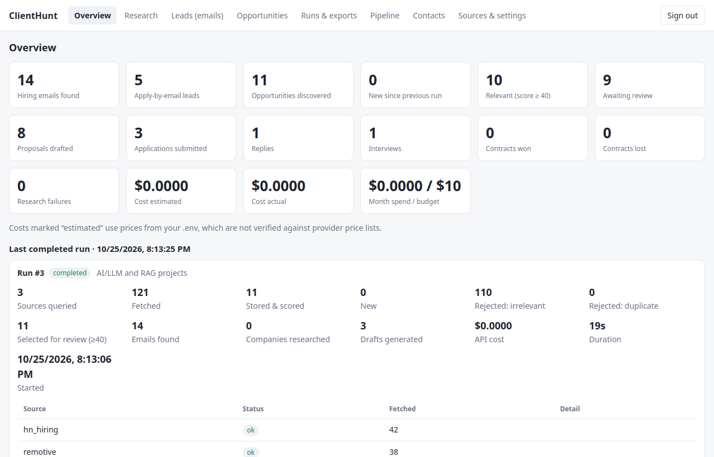
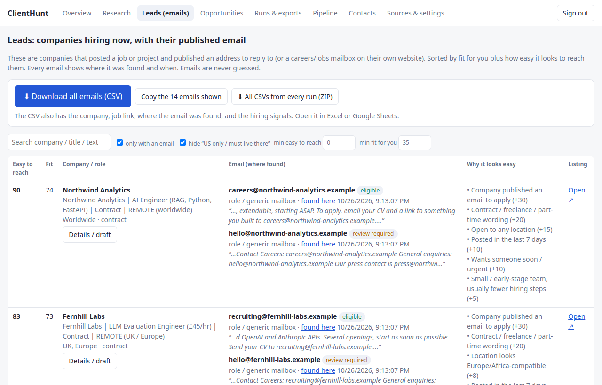
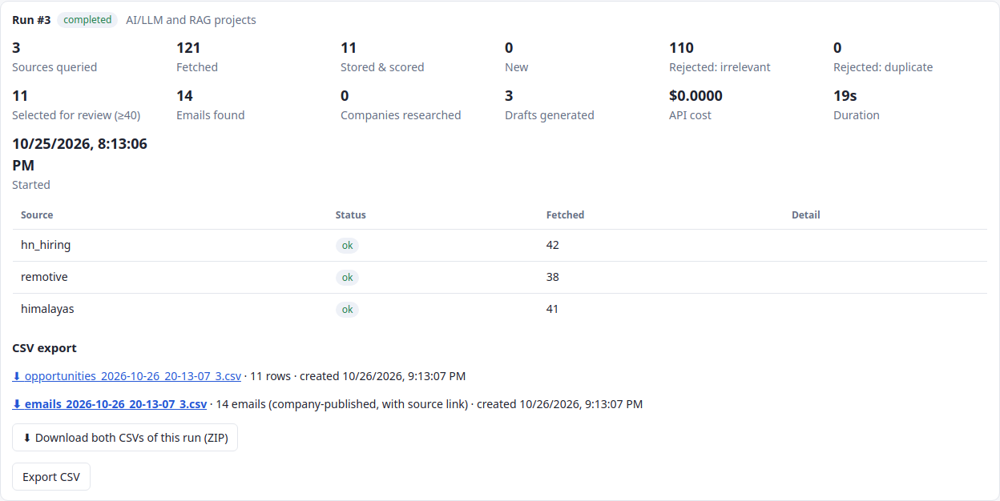
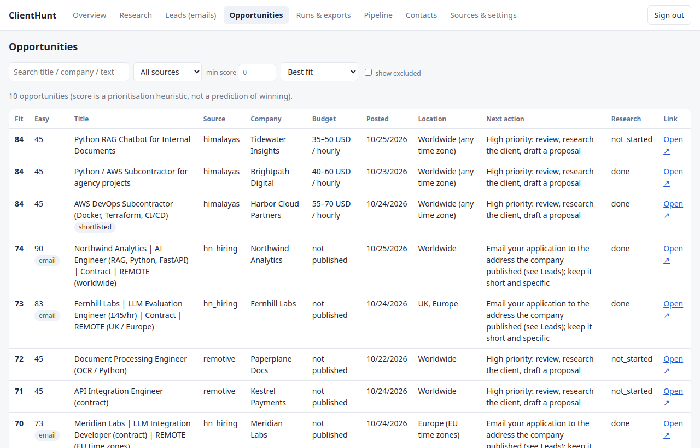
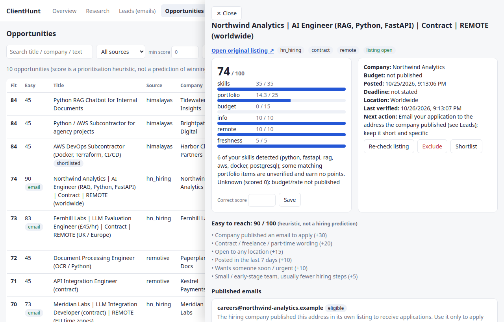
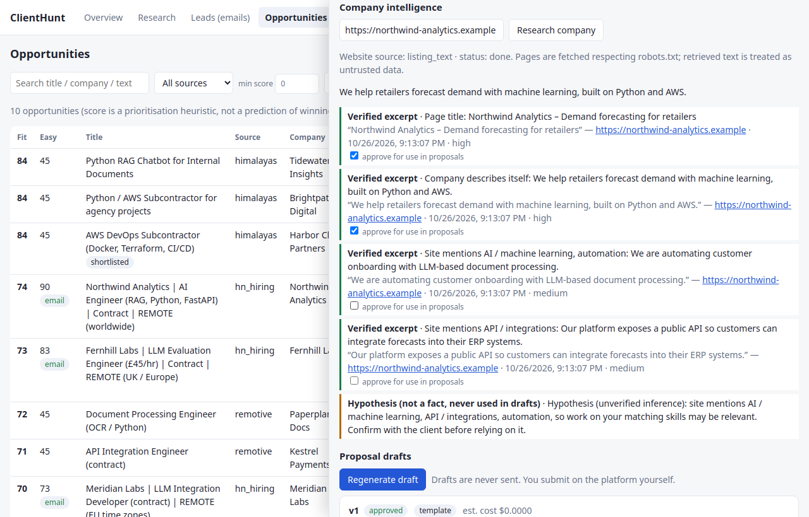
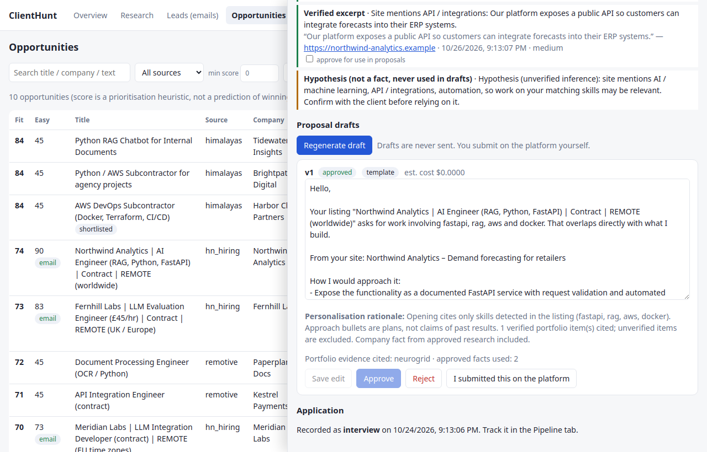
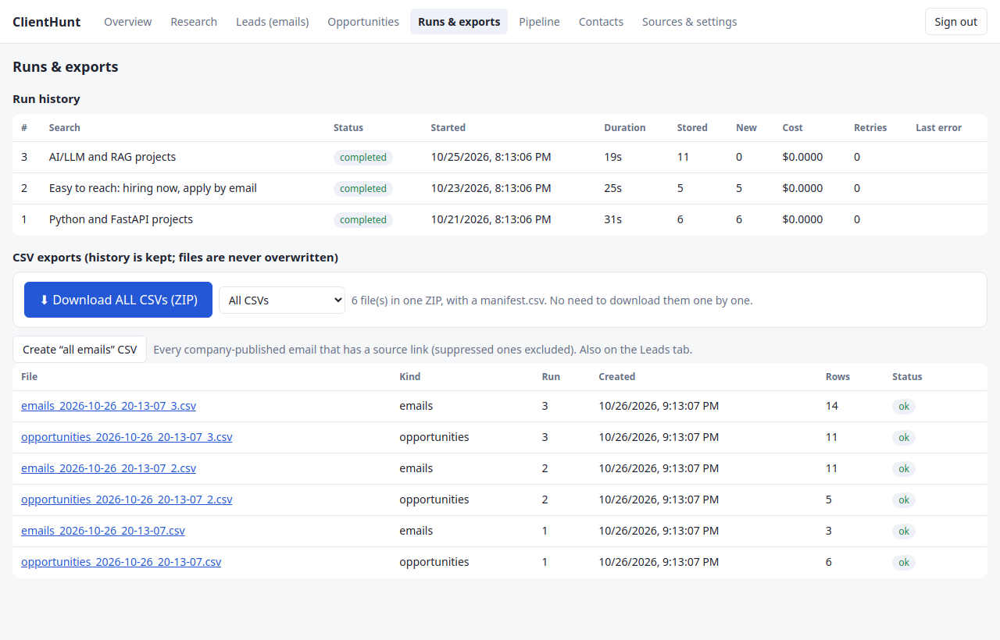
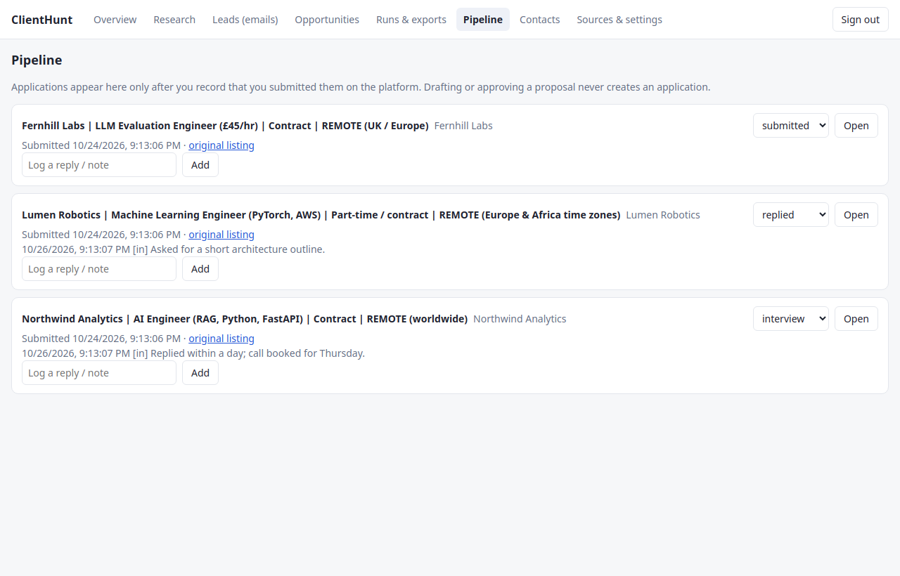

# ClientHunt

A private workspace for finding companies that need a Python / AI / LLM / RAG / FastAPI / AWS engineer **and
published an email to apply**. It ranks them transparently, researches the client from public sources with
evidence, drafts messages you review, and lets you download everything as CSV.
**It never sends or submits anything for you.**



*All screenshots use synthetic demo data: fictional companies and `.example` addresses. Nothing in them is a real
opportunity or a real person.*

## Tools used

**Database**: every run, opportunity, company, evidence quote, contact, draft, application and export is stored in a
database. SQLite by default (one file, `data/clienthunt.db`), PostgreSQL 16 with Docker Compose. Tables are created
and upgraded by Alembic migrations (3 so far) through the SQLAlchemy ORM.

[](https://www.sqlite.org/)
[](https://www.postgresql.org/)
[](https://www.sqlalchemy.org/)

**AI**: the app can use an LLM through the Claude API (Anthropic) to write proposal drafts. It is **off by default**,
capped per run and per month, and every draft goes through an unsupported-claim checker. Ranking, de-duplication,
email extraction and the "easy to reach" score are plain rules and need no model. This project was also built with the help
of AI (Claude Code).

[](https://www.anthropic.com/)

**Backend**

[](https://www.python.org/)
[](https://fastapi.tiangolo.com/)
[](https://docs.pydantic.dev/)

**Frontend**

[](https://react.dev/)
[](https://www.typescriptlang.org/)
[](https://vitejs.dev/)

**Testing and packaging** (Playwright is used for the browser test)

[](https://docs.pytest.org/)
[](https://vitest.dev/)
[](https://www.docker.com/)

## Screenshots

| | |
|---|---|
| **Leads: companies hiring now, with the email they published** <br>  | **A finished run: both CSVs and a ZIP of them** <br>  |
| **Opportunities, ranked by fit** <br>  | **Transparent score, "easy to reach" signals and published emails** <br>  |
| **Company research: verbatim quotes with source and time; inferences kept apart** <br>  | **Proposal draft with rationale, cited portfolio and approval gates** <br>  |
| **Download all CSVs in one ZIP** <br>  | **Pipeline: only what you really submitted** <br>  |

## What it does

| Area | Behaviour |
|---|---|
| **Leads and emails** | The **Leads** tab lists companies hiring now with the email *they* published (in their hiring post, or a careers/contact mailbox on their own website), plus where and when it was found. **Download all emails (CSV)** is one click, and every run also writes its own `emails_*.csv`. Emails are never guessed and never taken from Upwork or Fiverr. Each is marked `eligible` (the company invited applications there) or `review_required`. |
| **Download everything** | **Runs & exports → Download ALL CSVs (ZIP)** gives every opportunities/emails CSV in one file with a `manifest.csv`. There is also a ZIP per run. A file changed after export is left out and flagged. |
| Easy to reach | A 0–100 heuristic from visible signals: email to apply (+30), contract/freelance wording (+20), open to any location (+15), posted this week (+10), wants someone soon (+10), small team (+5), several openings (+5); minus for "no contractors/agencies" and location or work-authorisation limits. It shows *why*. It is not a hiring prediction. |
| Sources | Remotive, Remote OK, Himalayas and Hacker News "Who is hiring?" through their public APIs; **alert-email import** (Upwork, Contra, PeoplePerHour, Guru, Wellfound…); manual add. Upwork and Freelancer.com adapters say "not available" instead of faking a connection. |
| Ranking | 0–100: skills 35, portfolio relevance 25, budget 15, information quality 10, remote/location 10, freshness 5. Unknown data scores 0 and is listed. Location-restricted listings are capped at 50 and clearly non-engineering titles at 30. Only portfolio items you mark *verified* earn points or get cited. You can override a score or exclude a listing. |
| Company research | Fetches the company's own site (SSRF-safe, robots.txt respected). Facts are verbatim excerpts checked against the page, with URL and timestamp; inferences are stored separately as hypotheses and never used in drafts. You approve each fact before it can appear in a proposal. |
| Drafts | Free template drafts (from the listing, your verified portfolio and approved facts) or optional LLM drafts. The checker flags invented years, results, certifications, URLs, compliments and off-platform contact details. Editing resets approval. Approved is not submitted. |
| CSV | Created automatically for every completed or partial run (also with zero rows), timestamped, never overwritten, UTF-8 with BOM for Excel, spreadsheet-formula injection neutralised, SHA-256 recorded and checked on download. Failed runs produce no CSV; failed exports can be retried. |
| Jobs | Runs are database rows executed by a worker thread: pending, running, completed, partial, failed, cancelled, with progress, retries, cancel and restart recovery. |
| Contacts | Separate tables from opportunities. Source URL, date and snippet are kept for every address, with eligibility checks, a suppression list and a `forget` command. |

## Quick start (local, no Docker)

```bash
python3 -m venv backend/.venv && backend/.venv/bin/pip install -r backend/requirements-dev.txt
cd frontend && npm ci && npm run build && cd ..
cp .env.example .env            # set APP_PASSWORD and SESSION_SECRET (or run ./scripts/setup.sh)
cd backend && .venv/bin/alembic upgrade head
.venv/bin/uvicorn app.main:app --port 8765        # open http://127.0.0.1:8765
```

## Quick start (Docker, PostgreSQL)

```bash
./scripts/setup.sh              # writes .env with generated secrets and prints the login password
docker compose up -d --build    # http://127.0.0.1:8080  (bound to localhost only)
```

Put a TLS reverse proxy in front before exposing it beyond your machine, and set `COOKIE_SECURE=true`.

## How to use it

1. **Research** tab → pick a saved search (there are six, including **"Easy to reach: hiring now, apply by email"**) → **Run Research**.
2. Watch the run card: status, current source, counters, errors per source, cost.
3. **Leads** tab → **Download all emails (CSV)**. Or **Runs & exports → Download ALL CSVs (ZIP)**.
4. Open the original listing first. Use *Details / draft* to see the score breakdown, research the company and generate a draft.
5. Edit and approve the draft, submit it yourself on the platform or by your own email, then click *I submitted this*.
6. Track replies, interviews and outcomes in **Pipeline**.

For Upwork, create saved searches with email alerts there and paste the alert text into **Sources & settings → Alert import**.
Under **Sources & settings** you also mark which portfolio items are verified. Only verified items are scored and cited.

## Sources and access

| Source | Access | Notes |
|---|---|---|
| [Remotive](https://github.com/remotive-com/remote-jobs-api) | public API, no key | at most about 4 fetches a day (the app caches for 6 h), 24 h delay, link back and credit Remotive |
| [Remote OK](https://remoteok.com/api) | public API, no key | link back and credit Remote OK |
| [Himalayas](https://himalayas.app/api) | public API, free key optional | use the application link unchanged, link to Himalayas |
| [Hacker News](https://hn.algolia.com/api) | Algolia search API, no key | monthly "Who is hiring?" thread; rate limit not verified; comments are untrusted text |
| Upwork | [API needs approval](https://support.upwork.com/hc/en-us/articles/115015857647-How-to-request-an-API-key-from-Upwork) | scraping is not allowed, so it is used through alert emails you import |
| Fiverr, Freelancer.com, PeoplePerHour, Guru, Contra, Wellfound | none verified | no permitted discovery API was found; not scraped |

Source terms change, so check them before relying on this table.

## Safe by design

- Nothing is sent or submitted for you. Drafts need your approval, and "submitted" is only recorded when you say so.
- Emails come only from text the company published itself, always with source URL and date. They are format-checked, never "verified".
- `eligible` is a narrow judgement: the company invited applications at that address, so use it only for that purpose.
  Anything else is `review_required`. Suppress anyone who asks not to be contacted; `python -m app.cli forget someone@example.com`
  deletes a contact but keeps a suppression entry.
- Retrieved pages, job posts and files are treated as untrusted data. Instructions inside them are never followed.
- Login before any exposure, secrets only in `.env` (git-ignored), input validation and safe CSVs.
- Cold-email rules differ by country. This is not legal advice.

## Tests

```bash
cd backend && .venv/bin/python -m pytest -q          # 114 passed
cd frontend && npx vitest run                        # 15 passed (loading/error/empty states, CSV panel, Leads, ZIP)
cd frontend && npx playwright test                   # 1 passed (login → import → leads → emails CSV → ZIP → draft → approve → record)
```

Tests use synthetic data and mocked HTTP. No real email or application is ever sent. The app was also run against the real
public APIs: the CSV rows, URLs and checksums matched the database, and Docker Compose with PostgreSQL started, applied the
migrations and enforced login.

## Backups and troubleshooting

- SQLite backup: `./scripts/backup.sh` or `python -m app.cli backup` (also a button under Sources & settings).
  PostgreSQL backup: `./scripts/backup.sh docker` (pg_dump). Restore: `gunzip -c backups/pg_X.sql.gz | docker compose exec -T db psql -U clienthunt clienthunt`.
- `address already in use`: another program uses the port. Start with another one, for example `--port 8765`.
- "Cannot reach the server": the backend is not running or uses another port.
- A source shows `failed`: read its error on the run card, then use *Retry run*. Transient errors are already retried 3 times.
- Remotive returns the same results: intentional, it is cached for 6 hours to respect its fetch limit.
- A source shows `unavailable`: it needs authorisation or has no permitted API. Use Alert import.
- Export failed: check free disk space and permissions of `exports/`, then *Retry export* (this creates a new file).

## Limitations

- **Emails** are only those a company published itself. In the Hacker News thread roughly 1 in 3 matching posts carries one; Remotive,
  Remote OK and Himalayas use apply links. Website discovery (careers/contact mailboxes) only runs when the company website is known.
  An address is checked for format only; the app cannot tell you that it works or that anyone will answer.
- **Easy to reach** comes from keywords in the post. A post can say "ASAP" and still be slow. Always read the original listing.
- Free job APIs return few contract or freelance roles, and no number of leads or clients is promised.
- Hacker News posts are free text, so company and location parsing is heuristic. Skill detection is keyword based. Scores are
  a reading-order guide, not a prediction of winning.
- LLM drafting is tested with a mocked API only. It has not been run against the live Claude API, and the price defaults in
  `.env.example` are unverified.
- The built-in portfolio ships with one verified item. The others (RAG project, churn API, Vocality/Soni2) are placeholders marked
  unverified until you confirm them.
- The SSRF guard resolves DNS before fetching; a hostile DNS rebind between check and connect is not fully excluded.
- Single user and single worker. There is no IMAP polling yet.

## Next improvements

IMAP read-only alert polling; a Freelancer.com adapter once its documentation and terms are verified; a search provider for finding
official company sites (after checking current pricing); per-source quota dashboard; scheduled runs; contact discovery from official
team/contact pages; a procurement adapter.
